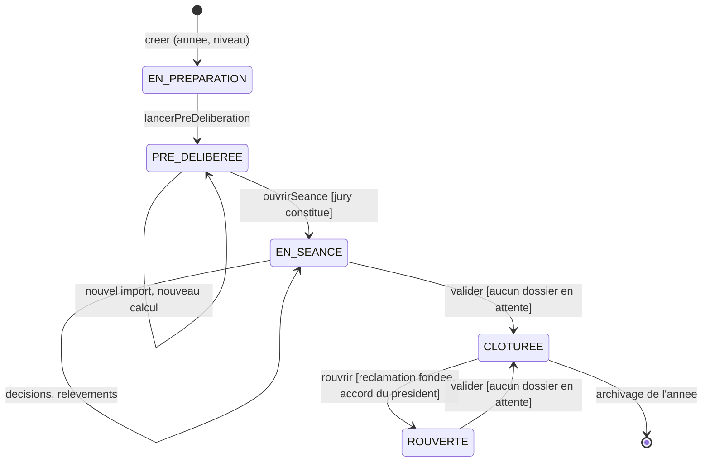

# M7 – Délibération et jury : spécifications

> **Sources** : cahier d'analyse v2.3 (§3.4 CU04 à CU08, CU14, CU17 ; §3.5 ; §4.2.4 ; §4.2.5 ; §4.2.7 ; §5.4, §5.6 à §5.8, §5.10, §5.11), cahier de conception (version en ligne de fin novembre 2026 : §4.2.2, §6.1.5, §6.1.6, §6.1.8, cycle de vie, algorithme A1), cahier des charges technique (BF09 à BF13, BF18, BF22, BNF03, BNF04, BNF06), Project Scope (T08, T09).
> Ce fichier est la référence pour développer le module. Les éléments marqués **[Proposition]** ne figurent pas dans les cahiers : faites-les valider par l'équipe avant de les implémenter.

## 1. Rôle

**Seul orchestrateur d'une délibération.** Le module gère :
- la création et le cycle de vie de la délibération ;
- la composition du jury ;
- la pré-délibération : il charge les données, appelle M6 et enregistre les situations ;
- les cas critiques, les décisions et les relèvements du jury ;
- la validation, la clôture et l'enregistrement des acquis ;
- la publication ;
- les réclamations et la réouverture.

**La plateforme propose, le jury décide.**

Paquetage : `com.delibera.deliberation`.

## 2. Exigences couvertes

| Code | Exigence |
| --- | --- |
| BF09, BF10 | Pré-délibérer et repérer les cas critiques (calcul délégué à M6). |
| BF12 | Confirmer, modifier ou rejeter une proposition, individuellement ou en lot ; relever une note d'EC **sans écraser la note d'origine**, avec un motif obligatoire et un recalcul immédiat ; validation finale par le président. |
| BF13 | Valider la délibération, puis générer le PV en séance (M8). |
| BF18 | Réclamations dans un délai paramétré après publication ; toute correction après signature passe par une réouverture tracée. |
| BF22 | Désigner pour chaque délibération un président et des membres ; leurs droits ne valent que pour elle. |
| BNF03 | Journaliser décisions, relèvements, réouvertures. |
| BNF04 | Délibération clôturée non modifiable, sauf réouverture tracée ; nouvelle version de situation à chaque recalcul. |
| BNF06 | Pré-délibération de 500 étudiants en moins de 30 s ; recalcul et PV en moins de 5 s. |

## 3. Acteurs et permissions

| Cas | Acteur | Permission |
| --- | --- | --- |
| CU04 Créer la délibération et lancer la pré-délibération | Gestionnaire académique | `PREDELIB_LANCER` (périmètre : le niveau) |
| CU17 Constituer le jury | Administrateur d'école | `JURY_CONSTITUER` |
| CU05 Examiner les cas critiques | Membre ou président **de ce jury**, gestionnaire, auditeur | `DOSSIER_CONSULTER` |
| CU06 Statuer sur un dossier, relever une note | Membre ou président **de ce jury** | `DOSSIER_STATUER` |
| CU08 Valider et clôturer | Président **de ce jury** | `DELIB_VALIDER` |
| CU14 Enregistrer et instruire une réclamation | Gestionnaire académique | `RECLAMATION_TRAITER` |
| CU14 Autoriser la réouverture | Président **de ce jury** | `REOUVERTURE_AUTORISER` |

Les droits de jury viennent de `MembreJury` et ne valent que pour la délibération concernée (algorithme A8, M1).

## 4. Cycle de vie d'une délibération



- Une délibération ne se modifie que dans les états `EN_PREPARATION`, `PRE_DELIBEREE`, `EN_SEANCE` et `ROUVERTE` (`estModifiable()`).
- Chaque transition vérifie sa condition et est journalisée.
- La publication a lieu dans l'état `CLOTUREE` et ouvre le délai de réclamation.
- La délibération suit la session normale **et** le rattrapage : les notes RAT sont importées avant l'ouverture de la séance (M5, CU07). Ensuite, seule une réouverture permet de corriger une note.

## 5. Cas d'utilisation

### CU04 – Lancer la pré-délibération

- **Préconditions** :
  - les notes de la session normale et du rattrapage sont importées ;
  - un jeu de paramètres est actif pour le niveau ;
  - chaque étudiant est couvert par au moins une règle active.
- **Scénario principal** :
  1. Le gestionnaire crée la délibération (année, niveau). Le système affiche les paramètres et les règles actifs (versions, seuils limites) et le nombre d'inscrits.
  2. Il lance le calcul (algorithme A1). Le système retient les inscriptions annuelles de l'année et du niveau, calcule chaque situation (M6), enregistre la version 1 avec sa proposition, et affiche les propositions avec leur explication. Il permet de filtrer par état.
- **Scénarios alternatifs** :
  - Aucun paramètre actif : calcul bloqué pour le niveau.
  - Aucune règle ne couvre un étudiant : dossier bloqué, gestionnaire informé.
  - Notes manquantes : dossier « incomplet ».
  - Notes RAT arrivées après le lancement : nouveau lancement, qui crée une nouvelle version des situations.
- **Postcondition** :
  - chaque étudiant a une situation et une proposition ;
  - les versions des paramètres et des règles (seuils limites compris) sont **figées** sur la délibération ;
  - chaque situation garde la règle qui lui a été appliquée.

### CU17 – Constituer le jury

- **Préconditions** : la délibération existe et n'est pas clôturée.
- **Scénario** : l'administrateur choisit **exactement un président** et **au moins un membre** parmi les comptes actifs de l'école. Le système enregistre la composition, la journalise et avertit les personnes désignées par courriel (M10).
- **Refus** : aucun président, ou plusieurs ; délibération clôturée (la composition ne change plus, sauf réouverture).
- La composition figure sur le PV.

### CU05 – Examiner les cas critiques

- **Préconditions** : la pré-délibération est terminée ; l'utilisateur est désigné dans ce jury.
- **Scénario** :
  1. Le système liste les étudiants `A_DELIBERER`, situés entre le seuil limite de leur règle et le seuil. Pour chacun : règle appliquée, seuil, seuil limite, écart.
  2. Il affiche les options de relèvement classées (EC, note actuelle, note cible, points ajoutés, crédits obtenus) et les UE prioritaires.
  3. Le membre filtre par filière ou par écart.
- Aucune option : le dossier est signalé et reste à trancher.
- Le seuil limite ne se modifie pas en séance : il fait partie de la règle figée.
- Aucune donnée n'est modifiée.

### CU06 – Statuer sur un dossier

- **Préconditions** : la délibération est en cours (non clôturée).
- **Avec un relèvement** :
  1. Le membre choisit une option (par exemple Algorithmique 2 de 8,5 à 10), saisit le motif et valide.
  2. Le système crée la `DecisionJury` et le `RelevementNote`, puis recalcule la situation dans une **nouvelle version** (45 crédits, proposition `ADMIS`). L'ancienne version reste consultable.
  3. Il journalise l'opération.
- **Sans relèvement** : le jury décide `ADMIS`, `AJOURNE` ou `SOUS_CONDITION`. Pour `SOUS_CONDITION`, il choisit les UE exigées parmi les UE non validées ; la plateforme propose les UE prioritaires.
- **Refus** :
  - motif absent (`MOTIF_OBLIGATOIRE`) ;
  - UE exigées sans `SOUS_CONDITION`, ou l'inverse ;
  - délibération clôturée.
- Deux décisions simultanées sur le même dossier : erreur **409** (verrou), et le client recharge le dossier.
- La décision peut aussi porter sur un lot de propositions (BF12) **[Proposition : route de décision en lot]**.

### CU08 – Valider la délibération

- **Préconditions** : tous les dossiers `A_DELIBERER` ont reçu une décision. Sinon, le système les liste et refuse la clôture.
- **Scénario** :
  1. Le président demande la validation ; le système affiche la synthèse.
  2. Le président confirme. Le système gèle la délibération (`CLOTUREE`), enregistre les **acquis** (`AcquisEC`, origine `DELIBERATION`, un seul par étudiant et par EC) et génère le PV et les listes (M8) pour signature sur place.
  3. La date de signature et le signataire sont ensuite enregistrés.
- Une erreur découverte après la clôture ne se corrige que par une réouverture (CU14).

### CU14 – Traiter une réclamation

- **Préconditions** : la délibération est clôturée **et publiée**.
- **Scénario** :
  1. Le gestionnaire enregistre la réclamation (étudiant, EC ou décision contestée, objet, motif). Le système vérifie le délai : date de dépôt ≤ date de publication + `delaiReclamationJours`.
  2. Si l'erreur est confirmée, le gestionnaire demande la réouverture et le **président l'autorise**. La réouverture est journalisée (motif, date, auteur), et la délibération passe à `ROUVERTE`.
  3. La correction est saisie (nouvelle note importée, ou relèvement). Le système recalcule une nouvelle version de la situation, sur laquelle le jury statue de nouveau.
  4. Le système génère un nouveau PV et de nouvelles listes, puis clôt la réclamation.
- **Hors délai** : réclamation enregistrée puis close avec le statut `HORS_DELAI`. **Non fondée** : close avec le statut `REJETEE`.

## 6. Modèle de données

Toutes les entités héritent de `EntiteEcole`.

### Deliberation

| Attribut | Type | Règle |
| --- | --- | --- |
| `statut` | `StatutDeliberation` | Cycle de vie (section 4) |
| `dateSeance` | `LocalDateTime` | |
| `dateCloture` | `LocalDateTime` | |
| `datePublication` | `LocalDate` | Point de départ du délai de réclamation |

Méthodes :
- `ouvrirSeance()`, `cloturer()`, `publier(LocalDate date)`, `rouvrir(String motif)` ;
- `estModifiable() : boolean`.

Associations :
- se tient en une `AnneeAcademique` et concerne un `Niveau` ;
- **fige** un `ParametreDeliberation` (1) et des `ReglePassage` (1..*), dans leur version ;
- examine des `SituationAcademique` (composition) ;
- réunit des `MembreJury` (composition, 1..*) ;
- consigne des `ProcesVerbal` ;
- est contestée par des `Reclamation` ;
- accorde des `AcquisEC`.

`Deliberation` **ne porte pas de seuil limite** : chaque situation lit celui de la règle qui lui est appliquée. Verrouillage optimiste (`verrou`).

### MembreJury

`qualite : QualiteJury` (`PRESIDENT`, `MEMBRE`), `dateDesignation : LocalDate`, `estPresident() : boolean`. Il désigne un `Utilisateur` (M1). Il prend des `DecisionJury` et peut signer des `ProcesVerbal`.

### DecisionJury

| Attribut | Type | Règle |
| --- | --- | --- |
| `etat` | `EtatDecision` | |
| `motif` | `String` | Obligatoire |
| `dateDecision` | `LocalDateTime` | |

Méthode : `estDifferenteDe(PropositionDecision p) : boolean`.

Associations : statue sur une `PropositionDecision` (0..1 par proposition) ; prise par un `MembreJury` ; ordonne des `RelevementNote` ; **exige** des `MaquetteUE` (0..*), seulement pour `SOUS_CONDITION`.

Verrouillage optimiste (`verrou`).

### RelevementNote

`ancienneValeur : BigDecimal`, `nouvelleValeur : BigDecimal`, `motif : String`, `dateRelevement : LocalDateTime`. Il modifie un `ResultatEC` (M6), **jamais une `Note`**.

### Reclamation

| Attribut | Type |
| --- | --- |
| `numero` | `String` (unique dans l'école) |
| `objet`, `motif` | `String` |
| `dateDepot` | `LocalDate` |
| `statut` | `StatutReclamation` |
| `issue` | `String` |

Méthodes :
- `estDansLeDelai(LocalDate publication, int delaiJours) : boolean`
- `instruire()`
- `cloturer(StatutReclamation statut, String issue)`

Associations : conteste une `Deliberation` ; déposée par un `Etudiant` ; porte sur un `ResultatEC` (0..1) ; enregistrée par un `Utilisateur`.

### Énumérations

| Énumération | Valeurs |
| --- | --- |
| `StatutDeliberation` | `EN_PREPARATION`, `PRE_DELIBEREE`, `EN_SEANCE`, `CLOTUREE`, `ROUVERTE` |
| `QualiteJury` | `PRESIDENT`, `MEMBRE` |
| `StatutReclamation` | `RECUE`, `EN_INSTRUCTION`, `ACCEPTEE`, `REJETEE`, `HORS_DELAI` |
| `EtatDecision` | Défini dans M6 (six états) |

## 7. Contraintes d'intégrité

```
context DecisionJury inv ueExigees:
  (self.etat = EtatDecision::SOUS_CONDITION) = self.maquetteUE->notEmpty()
  and self.maquetteUE->forAll(m |
    self.propositionDecision.situationAcademique.resultatUE
      ->exists(r | r.maquetteUE = m and not r.valide))

context SituationAcademique inv regleAppliquee:          -- voir M6
  self.deliberation.reglePassage->includes(self.reglePassage) ...
```

Autres règles :
- **Jury** : exactement un président, au moins un membre, tous comptes actifs de l'école.
- **Une délibération par année et par niveau** dans l'école **[Proposition]**.
- **Une seule situation en vigueur** par inscription et par délibération. Les versions précédentes restent consultables.
- Une décision porte sur la proposition d'une **version** de situation. Après une réouverture, l'ancienne décision reste attachée à l'ancienne version.
- **SOUS CONDITION** : l'étudiant reprend l'année suivante les UE exigées ; leurs EC non validés deviennent des dettes.

## 8. Algorithme A1 – Pré-délibération d'un niveau

```text
FONCTION lancerPreDeliberation(d : Deliberation)
  EXIGER d.statut DANS {EN_PREPARATION, PRE_DELIBEREE}
  inscriptions <- inscriptions annuelles de d.annee pour d.niveau
  CHARGER EN MEMOIRE, par requetes groupees : maquettes, enseignements, notes actives
          (session normale et rattrapage), acquis anterieurs et dettes ouvertes   // evite une requete par etudiant
  SI d.parametres = NUL ALORS                                            // premier lancement
    d.parametres <- parametresApplicables(d.annee, d.niveau)                      // A2, version figee
    d.regles <- regles actives partant de d.niveau, toutes portees       // versions figees, seuils limites compris
  FIN SI
  POUR CHAQUE ia DANS inscriptions FAIRE                                 // par lots de 50, en parallele
    r <- regleApplicable(ia, d)                                          // A2
    SI r = NUL ALORS signaler(ia, "aucune regle ne couvre l'etudiant") ; CONTINUER
    s <- calculerSituation(ia, d, avecRattrapage = VRAI)                 // A3 et A4
    s.regleAppliquee <- r
    s.proposition <- proposer(s, r, d)                                   // A5
    SI s.proposition.etat = A_DELIBERER ALORS
      c <- condition de credits derogeable qui a echoue
      s.proposition.options <- optionsRelevement(s, c)                   // A6
      s.proposition.uesPrioritaires <- uesPrioritaires(s, c)             // A7
    FIN SI
    enregistrer s comme version en vigueur ; la version precedente reste consultable
  FIN POUR
  d.statut <- PRE_DELIBEREE
  journaliser("PRE_DELIBERATION", d)
FIN
```

Toutes les données étant chargées en mémoire, chaque situation se calcule sans accès à la base, et l'enregistrement se fait par lots (Hibernate `batch_size` 50, identifiants par séquence). En cas de calcul parallèle, chaque fil reçoit l'école par `ContexteEcole.executerPour`.

## 9. Interfaces de service (cahier de conception, §6.1.8)

```java
public interface DeliberationService {
    Deliberation creer(Long anneeId, Long niveauId);
    void constituerJury(Long deliberationId, Long presidentId, List<Long> membreIds);
    void lancerPreDeliberation(Long deliberationId);
    DecisionJury statuer(Long propositionId, EtatDecision etat, String motif, List<Long> uesExigees);
    SituationAcademique relever(Long resultatEcId, BigDecimal nouvelleNote, String motif);
    ProcesVerbal valider(Long deliberationId);
    void publier(Long deliberationId);
    void rouvrir(Long deliberationId, Long reclamationId, String motif);
}
public interface ReclamationService {
    Reclamation enregistrer(Long deliberationId, Long etudiantId, Long resultatEcId, String objet, String motif);
    void cloturer(Long reclamationId, StatutReclamation statut, String issue);
}
```

**[Proposition]** À ajouter :
- `ouvrirSeance(Long deliberationId)` : transition `PRE_DELIBEREE` → `EN_SEANCE` ;
- méthodes de lecture pour CU05 : situations filtrées, cas critiques, dossier d'un étudiant avec ses versions.

## 10. API REST [Proposition]

| Verbe | Route | Permission |
| --- | --- | --- |
| GET, POST | `/api/v1/deliberations` | Lecture : `DOSSIER_CONSULTER` ; création : `PREDELIB_LANCER` |
| GET | `/api/v1/deliberations/{id}` | `DOSSIER_CONSULTER` |
| PUT | `/api/v1/deliberations/{id}/jury` | `JURY_CONSTITUER` |
| POST | `/api/v1/deliberations/{id}/pre-deliberation` | `PREDELIB_LANCER` |
| POST | `/api/v1/deliberations/{id}/seance` | À préciser (question 1) |
| GET | `/api/v1/deliberations/{id}/situations?etat=&filiere=&ecart=` | `DOSSIER_CONSULTER` |
| GET | `/api/v1/deliberations/{id}/cas-critiques` | `DOSSIER_CONSULTER` |
| GET | `/api/v1/situations/{id}` (dossier, versions, options, UE prioritaires) | `DOSSIER_CONSULTER` |
| POST | `/api/v1/propositions/{id}/decision` (avec le `verrou`) | `DOSSIER_STATUER` |
| POST | `/api/v1/resultats-ec/{id}/relevement` (avec le `verrou` de la situation) | `DOSSIER_STATUER` |
| POST | `/api/v1/deliberations/{id}/validation` | `DELIB_VALIDER` |
| POST | `/api/v1/deliberations/{id}/publication` | À préciser (question 2) |
| GET, POST | `/api/v1/deliberations/{id}/reclamations` | `RECLAMATION_TRAITER` |
| POST | `/api/v1/reclamations/{id}/cloture` | `RECLAMATION_TRAITER` |
| POST | `/api/v1/deliberations/{id}/reouverture` (réclamation, motif) | `REOUVERTURE_AUTORISER` |

Codes d'erreur à prévoir :

| Code | Statut HTTP |
| --- | --- |
| `DELIBERATION_NON_MODIFIABLE` | 422 |
| `DOSSIERS_EN_ATTENTE` | 422, avec la liste des dossiers |
| `MOTIF_OBLIGATOIRE` | 422 |
| `UE_EXIGEES_INCOHERENTES` | 422 |
| `JURY_INVALIDE` | 422 |
| `AUCUN_PARAMETRE_ACTIF` | 422 |
| `RECLAMATION_HORS_DELAI` | 422 |
| `MODIFICATION_CONCURRENTE` | 409 |

## 11. Dépendances

| Vers | Pour |
| --- | --- |
| M6 Calcul | Situations, propositions, options, UE prioritaires (`CalculService`, `MoteurReglesService`, `CasCritiquesService`) ; persistance des résultats |
| M4 Règles | `ResolutionService` (A2) ; règles et paramètres à figer |
| M5 Import | Inscriptions et notes (chargement groupé) ; création des `AcquisEC` à la clôture |
| M3 Référentiel | Année, niveau, maquettes |
| M1 Sécurité | Comptes actifs de l'école, pour composer le jury |
| M8 Documents | Génération du PV et des listes à la validation (`DocumentService`) |
| M10 Notifications | Avis de désignation dans un jury |
| M9 Audit | Toutes les transitions, décisions, relèvements et réouvertures |

Appelé par : M1 (appartenance au jury, A8), M5 (statut de la délibération, CU07), M8 (données du PV).

## 12. Journal d'audit

`DELIBERATION_CREEE`, `JURY_CONSTITUE`, `PRE_DELIBERATION`, `SEANCE_OUVERTE`, `DECISION_JURY` (ancienne proposition et nouvelle décision, T08), `RELEVEMENT_NOTE` (ancienne et nouvelle valeur, motif), `DELIBERATION_CLOTUREE`, `ACQUIS_ENREGISTRES`, `RESULTATS_PUBLIES`, `RECLAMATION_ENREGISTREE`, `REOUVERTURE` (motif, président), `RECLAMATION_CLOTUREE`.

Les noms `PRE_DELIBERATION` et `REFUS_ACCES` viennent du cahier ; les autres sont une **[Proposition]**.

## 13. Tests d'acceptation

**Cycle de vie et jury**
- Transitions permises et refusées : par exemple, une décision sur une délibération `CLOTUREE` est refusée.
- Jury sans président, ou avec deux présidents : refus.
- Un membre du jury d'une autre délibération reçoit 403.

**Pré-délibération (CU04)**
- 500 étudiants en moins de 30 s (test de performance).
- Versions des paramètres et des règles figées.
- Étudiant sans règle : signalé.
- Second lancement : nouvelle version des situations.

**Décisions (CU06)**
- Relèvement de l'exemple de Paul (8,5 → 10, motif) : version 2 en vigueur, 45 crédits, proposition `ADMIS` ; la version 1 reste consultable ; la note d'origine est intacte.
- Motif absent : refus.
- `SOUS_CONDITION` sans UE exigée, ou avec une UE validée : refus.
- Deux décisions simultanées : la seconde reçoit 409.

**Validation et réclamations (CU08, CU14)**
- Validation avec des dossiers `A_DELIBERER` sans décision : refus, avec la liste des dossiers.
- Validation correcte : `CLOTUREE`, acquis créés une seule fois par EC, PV généré.
- Réclamation hors délai : `HORS_DELAI`.
- Réouverture : `ROUVERTE`, nouvelle version, nouveau PV ; l'ancien PV est conservé.

**Project Scope**
- **T08** : une modification manuelle du jury enregistre la décision et laisse une trace d'audit avec l'utilisateur, la date, l'ancienne proposition et la nouvelle décision.
- **T09** : une règle modifiée après une délibération : la délibération garde la version historique.

## 14. Questions ouvertes

1. Qui ouvre la séance (`PRE_DELIBEREE` → `EN_SEANCE`), et avec quelle permission ? La matrice §3.5 ne le précise pas. Proposition : le président (`DELIB_VALIDER`) ou le gestionnaire (`PREDELIB_LANCER`).
2. Qui publie les résultats, et avec quelle permission ? Proposition : le gestionnaire (`PV_GENERER`).
3. Décision en lot (BF12) : sur quels critères (toutes les propositions `ADMIS` confirmées d'un coup) ?
4. Dépendances circulaires M7 ↔ M8 (PV) et M7 ↔ M1 (jury) : M7 transmet-il à M8 un `record` avec les données du PV, plutôt que l'identifiant de la délibération ?
5. Plusieurs délibérations pour le même niveau et la même année (par filière) sont-elles possibles ?
